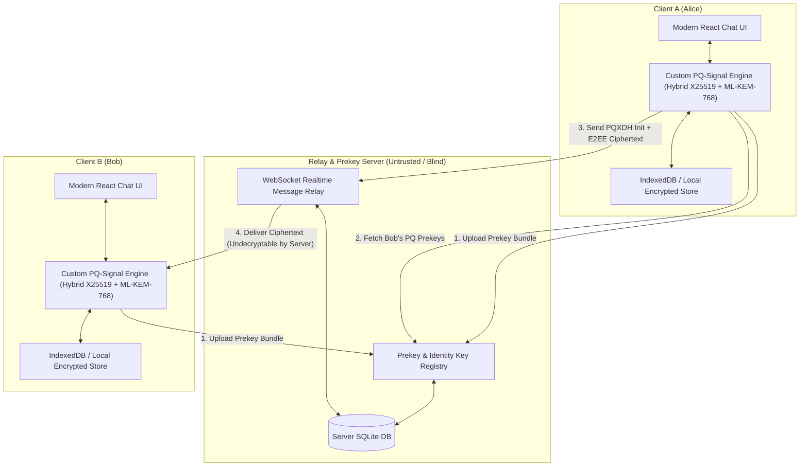

# Quantum-Secure E2EE Messaging Application (PQ-Signal Protocol)

## Goal Description
Build a full-fledged, product-grade end-to-end encrypted (E2EE) messaging application implementing a custom **Quantum-Resistant Signal Protocol variant**. 

Standard Signal Protocol relies on:
1. **X3DH** (Extended Triple Diffie-Hellman) based on Curve25519 / X25519 for asynchronous initial key exchange.
2. **Double Ratchet** (Diffie-Hellman ratchet + symmetric KDF ratchets) for forward secrecy and post-compromise security / break-in recovery.

Because Shor's algorithm on a cryptographically relevant quantum computer (CRQC) breaks discrete logarithm problems (and thus Curve25519/ECDH), this project implements:
1. **PQXDH (Post-Quantum Extended Triple Diffie-Hellman)**: Combining classical ECDH (X25519) with a post-quantum Key Encapsulation Mechanism (KEM) — specifically NIST-standardized **ML-KEM-768 / Kyber-768** in a hybrid construction. Hybrid design guarantees that communication remains at least as secure as classical cryptography even if mathematical flaws are discovered in new lattice constructions, while defeating harvest-now-decrypt-later (HNDL) attacks.
2. **PQ-Double-Ratchet**: Hybrid DH + KEM asymmetric ratchet combined with standard HKDF-SHA256 symmetric chain ratchets.
3. **Product-Grade UI & Client-Server Architecture**:
   - Modern, polished Web / Desktop-ready frontend (React, Tailwind CSS, Lucide icons, real-time WebSocket connection, responsive chat UI, contacts, QR code key verification / security numbers, multi-session tabs).
   - Lightweight, robust backend signaling and prekey bundle server (FastAPI or Node.js/Express with WebSockets and SQLite) for blind message relay and public prekey directory.
   - Comprehensive cryptographic test suite validating forward secrecy, post-compromise security, replay protection, and out-of-order message decryption.

---

## Architecture Overview



---

## Detailed Protocol Specification

### 1. Cryptographic Primitives (Hybrid Post-Quantum)
- **Classical Asymmetric**: X25519 (ECDH) + Ed25519 (Signatures).
- **Post-Quantum KEM**: **ML-KEM-768** (formerly CRYSTALS-Kyber-768, FIPS 203 standardized), offering NIST Security Level 3 (~AES-192 equivalent).
- **Symmetric Cipher**: AES-256-GCM or ChaCha20-Poly1305 with 128-bit authentication tags and unique 96-bit nonces.
- **Key Derivation Function (KDF)**: HKDF-SHA256.

### 2. Hybrid PQXDH (Initial Key Exchange)
Bob publishes his prekey bundle to the server:
- $IK_B$: Identity Key (Ed25519 & X25519)
- $SPK_B$: Signed Prekey (X25519 + ML-KEM-768 public key), signed with Bob's $IK_B$
- $OPK_B$: One-time Prekeys (Pool of ephemeral X25519 + ML-KEM-768 keys)

When Alice initiates a session:
1. Alice retrieves Bob's bundle: $\{IK_B, SPK_B, OPK_B\}$.
2. Alice verifies Bob's signature on $SPK_B$.
3. Alice generates:
   - Ephemeral X25519 keypair: $EK_A$
   - Encapsulates to Bob's ML-KEM signed prekey: $(CT_{kem1}, SS_{kem1}) = \text{ML-KEM.Encaps}(PK_{kem,B})$
   - Encapsulates to Bob's ML-KEM one-time prekey: $(CT_{kem2}, SS_{kem2}) = \text{ML-KEM.Encaps}(OPK_{kem,B})$
4. Alice computes classical DHs:
   - $DH_1 = \text{X25519}(IK_A, SPK_B)$
   - $DH_2 = \text{X25519}(EK_A, IK_B)$
   - $DH_3 = \text{X25519}(EK_A, SPK_B)$
   - $DH_4 = \text{X25519}(EK_A, OPK_B)$
5. Master Secret Combination (Hybrid KDF):
   $$SK = \text{HKDF-Extract}(0, DH_1 \parallel DH_2 \parallel DH_3 \parallel DH_4 \parallel SS_{kem1} \parallel SS_{kem2})$$
6. Alice sends to Bob: Alice's $IK_A$, $EK_A$, $CT_{kem1}$, $CT_{kem2}$, and the first encrypted message.

### 3. PQ-Double Ratchet
- **Symmetric Ratchet**: Per-message KDF ratchets for sending and receiving chains (identical to Signal, providing forward secrecy within a ratchet step).
- **Hybrid Asymmetric DH + KEM Ratchet**: Whenever a reply is received, a new hybrid ratchet turn is executed. Each party encapsulates an ML-KEM secret and computes a new X25519 DH, mixing both into the root KDF chain:
  $$RK_{i+1}, CK_{send} = \text{HKDF}(RK_i, DH(EK_{curr}, EK_{peer}) \parallel SS_{kem})$$
  This guarantees Post-Compromise Security (self-healing) even against an adversary possessing a quantum computer.

---

## Protocol Implementation Scope: From-Scratch Protocol Architecture in Python

> [!IMPORTANT]
> **Strict "No High-Level Protocol Library" Rule Adherence**:
> We will **not** use `libsignal`, `signal-protocol`, `matrix`, or any existing messaging/protocol library.
> 
> The protocol will be written entirely from scratch in clean, modular Python:
> 1. **Custom PQXDH State Machine (`pqxdh.py`)**:
>    - Prekey bundle construction and validation from scratch.
>    - Multi-DH + Post-Quantum KEM secret derivation logic.
>    - Hybrid key combination using raw HKDF extracts and expands.
> 2. **Custom Hybrid Post-Quantum Double Ratchet (`ratchet.py`)**:
>    - Root Key KDF chain state transition logic written from scratch.
>    - Sending & Receiving symmetric KDF ratchet chains.
>    - Out-of-order message key store & skipped message key management.
>    - Hybrid asymmetric ratchet (X25519 + ML-KEM step) triggered upon turn-taking.
> 3. **Custom Packet Serialization & Framing (`types.py` & `envelope.py`)**:
>    - Custom packet format: headers, ephemeral keys, KEM ciphertexts, counter indices ($N, PN$), authentication tags, and ciphertexts.
> 4. **Allowed Primitive Primitives vs Forbidden Protocol Libraries**:
>    - **Forbidden**: High-level libraries (libsignal, OMEMO libraries, ready-made chat encryption wrappers).
>    - **Allowed & Standard**: Low-level math/primitive algorithms only (e.g. `cryptography` primitive interfaces for raw AES-256-GCM, SHA-256/HKDF, and raw X25519 scalar multiplication, alongside reference ML-KEM-768/Kyber encapsulation). All session state, ratchets, message sequencing, key derivation pipelines, and handshake flows are 100% our own code.

---

## Proposed Project Structure

```
pq-signal-messenger/
├── pq_signal/                     # Custom Post-Quantum Signal Protocol core engine (100% from scratch)
│   ├── __init__.py
│   ├── primitives.py              # Low-level primitives: X25519, ML-KEM-768, HKDF, AES-256-GCM
│   ├── pqxdh.py                   # Custom Hybrid PQXDH handshake (initiation & response)
│   ├── ratchet.py                 # Custom Hybrid PQ-Double Ratchet engine
│   ├── state.py                   # Session, prekey bundles, and skipped keys storage
│   ├── envelope.py                # Wire format serialization & parsing
│   └── types.py                   # Type definitions & data structures
├── server/                        # Blind signaling & prekey directory server
│   ├── app.py                     # FastAPI application with WebSocket real-time relay
│   └── models.py                  # In-memory / SQLite prekey directory & message queue
├── client/                        # Product-Grade Web Application UI
│   ├── static/
│   │   ├── css/style.css          # Modern dark/light styling (Tailwind-like aesthetics)
│   │   ├── js/app.js              # Client UI controller, real-time chats, protocol inspector
│   │   └── index.html             # Multi-session product interface (Alice & Bob tabs or side-by-side)
├── tests/                         # Pytest test suite validating the custom protocol
│   ├── test_pqxdh.py              # Test hybrid PQXDH handshake correctness
│   ├── test_ratchet.py            # Test forward secrecy, ratchet turns, & out-of-order delivery
│   └── test_tamper.py             # Test tampering resistance and MITM detection
├── requirements.txt
└── README.md                      # Academic report, cryptographic specification, and user guide
```
│   │   │   ├── lib/               # Protocol wrapper & storage adaptor
│   │   │   └── App.tsx            # Main layout with dual-session test mode or multi-tab sync
│   └── package.json               # Monorepo / workspace configuration
└── README.md                      # Academic documentation & protocol whitepaper
```

---

## Key Product Features
1. **Interactive Chat UI**:
   - Modern dark/light theme, message status ticks (sent, delivered, decrypted), timestamps.
   - Live real-time bidirectional messaging via WebSockets.
2. **Cryptographic Transparency Inspector**:
   - Built-in "Protocol Inspector" drawer showing live session state: Root Key, Chain Keys, Ratchet Number, KEM public keys, and cryptographic logs showing each ratchet step.
3. **Safety Numbers & QR Code Verification**:
   - Visual fingerprint comparing Alice and Bob's hybrid identity keys to detect and prevent Man-In-The-Middle (MITM) attacks.
4. **Resilience & Testing Features**:
   - Out-of-order message delivery handling (skipped keys pool).
   - Tamper-detection warning banner when ciphertext or tag is modified in transit.
   - Demo "Dual Window" or Multi-user mode in one click to easily demo to professors/evaluators.

---

## Verification Plan

### Automated Tests
1. **PQXDH Handshake Test**: Alice and Bob complete handshake; verify identical shared master keys derived.
2. **PQ-Double Ratchet Test**:
   - Ping-pong message exchanges trigger asymmetric KEM + DH ratchets.
   - Uni-directional bursts trigger symmetric KDF ratchets.
3. **Out-of-order Delivery Test**: Deliver message 3 before message 1 and 2; verify all decrypt correctly via skipped keys.
4. **Tamper Test**: Flip 1 bit in ciphertext; verify AES-GCM tag verification failure.

### Manual Verification
1. Launch server and client web app (`npm run dev`).
2. Open two browser windows (Alice and Bob).
3. Exchange prekeys and establish quantum-resistant session.
4. Open the Protocol Inspector in the UI to confirm ratchet turns and ML-KEM encapsulations occur in real time.
5. Verify Safety Numbers match across both windows.
